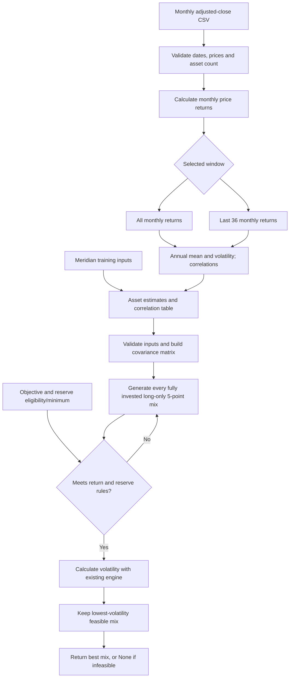

# Thursday: lowest-risk mix and estimation risk

Built with AI help, a learning demonstration, not investment advice.

Question: Which mix carries the least risk while meeting the mandate — and does the answer survive a one-point change in one estimate?

## Run

From this folder:

```powershell
python -m pip install -r requirements.txt
python portfolio.py
python -m unittest test_portfolio test_search -v
python -m streamlit run app.py
```

The app imports the engine's inputs, search and CSV estimator. It reloads the engine on a page rerun, so saving a correlation change and refreshing uses the new inputs. It contains no portfolio return or volatility formula.

## Verified training results

Order: bills / 10-year note / IG / equity. Objective 6.5%; reserve minimum 3%; bills and note eligible.

| Run | Weights (%) | Return (%) | Volatility (%) |
|---|---|---:|---:|
| Loaded estimates | 0 / 20 / 25 / 55 | 6.51 | 9.44 |
| Equity estimate 8% to 7% | 0 / 10 / 10 / 80 | 6.53 | 12.94 |
| IG–equity correlation 0.50 in both cells | 0 / 40 / 0 / 60 | 6.52 | 9.73 |

Largest weight change from the return stress: **25 percentage points**, in equity. The original correlation remains 0.25 in the saved engine.

Seven engine tests passed. The CLI output after the changes was compared byte for byte with the repository's original script and is unchanged. App and engine syntax checks passed.

Runtime limitation: the active Python environment has no Streamlit, pandas or NumPy. Installation failed because network access to PyPI was blocked (WinError 10013). The Streamlit page and CSV estimation have not been runtime-verified here. Run the install and launch commands above in your normal environment before claiming the app checkout.

## Engine flowchart



The command-line entry point still calculates and prints Tuesday's three baseline portfolios. The app uses the new search path. It runs an all-months loaded baseline and the current edited/window inputs under the same selected mandate and eligibility.

## Estimation risk

Estimation risk is the risk that the inputs differ from future realized returns, volatilities or correlations. A historical average describes the sample, not a forecast.

The search selects a winner from many competing mixes. Small return changes can move mixes across the objective threshold and make a different allocation the lowest-risk feasible choice. The 5-point grid can also create jumps. Here, lowering equity's estimate forces more equity to reach 6.5%: equity rises from 55% to 80%, while volatility rises from 9.44% to 12.94%. The result is sensitive to the estimate.

## Personal checkout: pending student inputs

No Project 2 fund list, personal mandate or prices.csv was present in the repository. No prices, source dates, partner observations or personal decisions have been invented.

- Universe: pending (three to six funds).
- Numeric objective and hard constraint: pending.
- For each ticker: fund name, role, price source and actual download date: pending.
- Five years of consecutive monthly adjusted closes: pending.
- All-months answer: pending.
- Last-36-return answer: pending.
- Largest weight change, if both answers are feasible: pending.
- Partner's actual estimate change and two-sentence response: pending.
- Your adopt/pilot/reject decision and condition tied to the stress result: pending.
- Your reflection on what evidence would be needed before adoption: pending.

Do not lower the objective to manufacture a feasible answer. When no mix qualifies, record that result. This app checks the selected return and reserve rules; it does not establish compliance with every clause in the original Meridian mandate.
